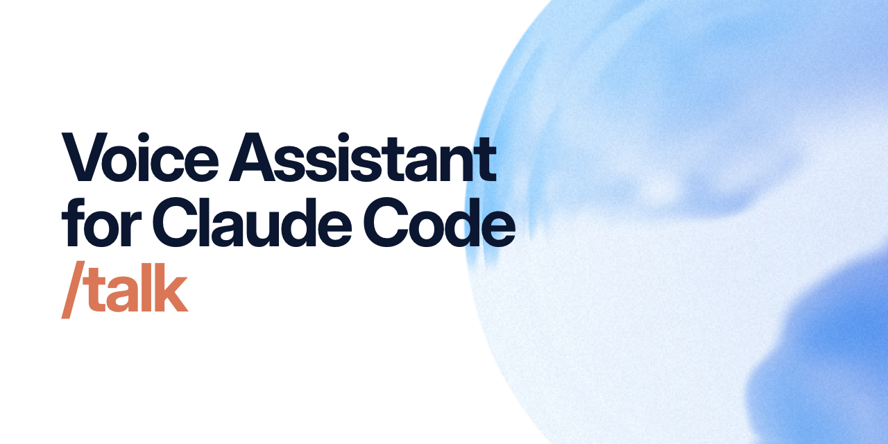

# Voice Assistant for Claude Code

<picture>
  <source media="(prefers-color-scheme: dark)" srcset="docs/banner-dark.png">
  
</picture>

Talk to Claude Code out loud, and it talks back. Type `/talk` in the Claude desktop app and a small orb appears: say what you want, and a fast voice assistant answers you or hands the work to your session, then tells you how it went. You can keep talking while it works, interrupt it, or ask what it's doing.

It's not dictation. Claude Code's built-in `/voice` turns your speech into a prompt. Voice Assistant is a conversation partner that sits beside your session:

- **Open mic.** No push-to-talk. Echo cancellation lets you talk over it on speakers.
- **Answers out loud.** It explains what the session did, reads out its questions, and tells you when work finishes.
- **Passes work on.** "Fix the login test and run the suite" goes to the session in your words; while it's busy, voice queues the next request.
- **Only your voice.** After it learns your voice, other people in the room are ignored.
- **Local speech.** Speech recognition and the voice run on your Mac. Only text goes to Claude.
- **Seven languages.** English, Spanish, French, Italian, Portuguese, Hindi, and Hebrew (experimental).

## Requirements

- A Mac with Apple silicon (M1 or later). Tested on macOS 26.
- The **Claude desktop app** with a recent Claude Code. Voice mode is a desktop plugin; it doesn't run in the terminal CLI.
- A **Claude subscription** (Pro or Max). The voice assistant runs on Claude Haiku through your subscription, never on API billing.
- [uv](https://docs.astral.sh/uv/): `curl -LsSf https://astral.sh/uv/install.sh | sh`
- Xcode's command line tools: `xcode-select --install`
- Up to 6.5 GB of free disk: 1.9 GB of Python packages plus your language's speech models (English 4.0 GB, Hebrew 2.8 GB, the others 4.4 GB).
- A microphone, and speakers or headphones.

## Install

1. In the Claude desktop app, in any Code session, type:
   ```
   /plugin install voice-mode --marketplace labsdotglass/voice-assistant
   ```
2. Restart the Claude app.
3. Type `/talk` (or press **Start voice** under the prompt).

The first time, a window walks you through the rest: pick your language, wait for the download (a progress bar; take the short tour meanwhile), and read eight short phrases so voice learns your voice. macOS asks to let **Voice Assistant** use the microphone: allow it.

When the orb is in the corner of your screen, start talking. The first time you ask for the next session ("next session"), macOS also asks to let Voice Assistant control the computer (Accessibility): it presses the app's own shortcut for you. It's optional.

**Recommended: auto mode.** Voice can't click a permission prompt, so a session stops at each one until you do. To have sessions run without prompts, add `"defaultMode": "auto"` under `"permissions"` in `~/.claude/settings.json`, or run `uv run setup.py --auto-mode` in the plugin's folder to have it done (it keeps a copy of the file). Voice never turns it on by itself.

## Using it

- **Talk normally.** Ask a question, ask for work, think out loud. Voice decides whether to answer itself or send your request to the session.
- **Questions from the session** are read out. Answer out loud or on screen, whichever is easier.
- **Stop or redirect:** "stop that", "actually, do the tests first". Voice checks with you before it interrupts.
- **Other sessions:** "what sessions do I have?", "go to the pricing session", "start a new session in my-app and have it run the tests". Voice tells you when a session you're not looking at finishes or needs you.
- **End:** say goodbye, or right-click the orb → **Stop voice**. `/talk` toggles it.
- **The orb:** drag it anywhere; it snaps to edges. A small badge above it counts queued requests; click it for the list.

### The orb's menu

Right-click the orb. Everything here also works by voice ("switch to Michael's voice", "show the transcript", "turn off progress updates").

| Item | What it does |
|---|---|
| **Show / Hide transcript** | The Voice panel beside your session: what you said and what voice said |
| **Clear conversation** | Start the voice conversation fresh |
| **Language** | The language you speak and voice answers in |
| **Voice** | The voice it speaks with (eight for English) |
| **Pass on my words** | **Concise** (default) sends your request in as few words as carry it; **Cleaned up** keeps your wording minus fillers and slips |
| **More** | **Learn my voice again**, **Show the tour**, **Progress updates** |
| **Stop voice** | Turn voice off |

Slash commands: `/talk`, `/voice-enroll` (learn your voice again), `/voice-tour`, `/voice-panel` (reopen the transcript).

## Privacy

- **Stays on your Mac:** your audio, speech recognition, the voice, your voice print and the recordings it's built from. All of it lives in `~/.voice-assistant`, readable only by you.
- **Goes to Claude (Anthropic):** the text of what you say, and the session's recent activity so the assistant knows what's going on. This goes through your Claude subscription, like any Claude Code session.
- **Downloads:** Python packages from PyPI on the first start, the speech models from Hugging Face (which also checks them for updates when they load), and Kokoro's voice files from GitHub.

Nothing else is sent anywhere: voice adds no telemetry.

## Updating

```bash
claude plugin marketplace update voice-assistant
claude plugin update voice-mode@voice-assistant
```

Then restart the Claude app. Your settings and voice print stay in `~/.voice-assistant`.

## Uninstalling

```bash
claude plugin uninstall voice-mode@voice-assistant
rm -rf ~/.voice-assistant
```

The speech models stay in Hugging Face's cache (`~/.cache/huggingface/hub`, one folder per model in the table below) and Kokoro's voice files in `~/.cache/pipecat/kokoro-onnx`, in case other apps use them; delete them to reclaim the space. Voice Assistant's microphone and Accessibility entries can be removed in System Settings → Privacy & Security.

## Troubleshooting

The log is `~/.voice-assistant/logs/voice.log`; its last lines usually say what went wrong.

| What you see | What to do |
|---|---|
| `/talk` does nothing, or "couldn't start" | Read the last lines of the log |
| "Voice mode needs uv" | Install uv (see Requirements), then `/talk` again |
| "Not on the claude.ai subscription" in the log | `claude auth login`, and pick your Claude account |
| No orb, or "couldn't build" in the log | `xcode-select --install`, then `/talk` again |
| The window says a download failed | Check your network, then press **Retry** |
| Voice never hears you | System Settings → Privacy & Security → Microphone: turn on Voice Assistant, then `/talk` twice |
| It ignores what you say | `/voice-enroll`, and read the phrases again |
| It answers other people | Learn your voice again; in a noisy room, use headphones |

`uv run setup.py`, run in the plugin's folder (the `installPath` that `claude plugin list --json` shows), checks everything voice needs and lists what to fix.

## Configuration

Environment variables, read when voice starts:

| Variable | Default | What it does |
|---|---|---|
| `VOICE_PROJECTS` | the first of `~/dev`, `~/Developer`, `~/code`, `~/projects`, `~/src`, else `~` | Where "a new session in my-app" looks for `my-app` |
| `TALKER_MODEL` | `claude-haiku-5-5` | The voice assistant's model |
| `WHISPER_MODEL` | `mlx-community/whisper-large-v3-mlx` | Speech recognition (all languages but Hebrew) |
| `SPEAKER_CUTOFF` | `0.33` | How close a voice must be to yours to be answered |
| `VOICE_GREETING` | `1` | `0` turns the start-up greeting off |
| `VOICE_ORB` | `1` | `0` hides the orb |
| `VOICE_ENROLL` | `1` | `0` stops voice offering to learn your voice (the first run's window still asks once) |
| `VOICE` | `af_heart` | The voice when none is picked in the menu |
| `VOICE_ALLOW_API` | unset | `1` lets the assistant run on API billing instead of refusing it |
| `LOG_LEVEL` | `INFO` | How much goes into the log |

Switches: `touch ~/.voice-assistant/progress-off` stops spoken progress updates while the session works (the menu's **Progress updates** does the same).

## Models and licenses

The code is MIT. Voice downloads only your language's models; each keeps its own license.

| Model | Used for | Source | License |
|---|---|---|---|
| Whisper large-v3 (MLX) | Speech recognition | [mlx-community/whisper-large-v3-mlx](https://huggingface.co/mlx-community/whisper-large-v3-mlx) | MIT |
| ivrit.ai Whisper v3 turbo (MLX) | Hebrew speech recognition | [el-gast/ivrit-v3-turbo-q8-mlx](https://huggingface.co/el-gast/ivrit-v3-turbo-q8-mlx) | Apache-2.0 |
| faster-whisper base.en, small | The live draft while you talk | [Systran](https://huggingface.co/Systran) | MIT |
| Kokoro-82M (MLX, ONNX) | The voice | [hexgrad/Kokoro-82M](https://huggingface.co/hexgrad/Kokoro-82M), [mlx-community](https://huggingface.co/mlx-community/Kokoro-82M-bf16), [kokoro-onnx](https://github.com/thewh1teagle/kokoro-onnx) | Apache-2.0 |
| **Hebrew Kokoro** | Hebrew's voice | [thewh1teagle/kokoro-hebrew-nc](https://huggingface.co/thewh1teagle/kokoro-hebrew-nc) | **Non-commercial** ([SASPEECH](https://www.openslr.org/134/) terms) |
| Phonikud | Hebrew vowels and stress | [thewh1teagle/phonikud-onnx](https://huggingface.co/thewh1teagle/phonikud-onnx) | MIT |
| SpeechBrain ECAPA-TDNN | Recognizing your voice | [speechbrain/spkrec-ecapa-voxceleb](https://huggingface.co/speechbrain/spkrec-ecapa-voxceleb) | Apache-2.0 |
| Silero VAD, Smart Turn v3 | Hearing when you speak and when you've finished | bundled with [Pipecat](https://github.com/pipecat-ai/pipecat) | MIT, BSD-2-Clause |

**Hebrew's voice is for non-commercial use only.** It's downloaded only if you choose Hebrew.

## How it works

```
mic → echo cancellation → voice detection + end-of-turn → Whisper → is it you? → Claude Haiku → Kokoro → speakers
                                                                                     ↕
                                                                          your Claude Code session
```

A Python daemon ([Pipecat](https://github.com/pipecat-ai/pipecat)) runs the audio pipeline on your Mac. A small Swift app handles the microphone and speakers with macOS's echo cancellation and draws the orb. A Claude Code plugin connects each session to the daemon, so the assistant sees what the session does and can send it work. More in [docs/architecture.md](docs/architecture.md).

## Contributing

Issues and pull requests are welcome. [CONTRIBUTING.md](CONTRIBUTING.md) covers setting up a clone, running the checks and changing how the assistant speaks.

## License

[MIT](LICENSE), © 2026 Glass Labs. The orb and its UI parts in `orb-page/src/ui/` come from Glass Labs' design system and are MIT too ([notice](orb-page/src/ui/NOTICE.md)). Built on [Pipecat](https://github.com/pipecat-ai/pipecat).
